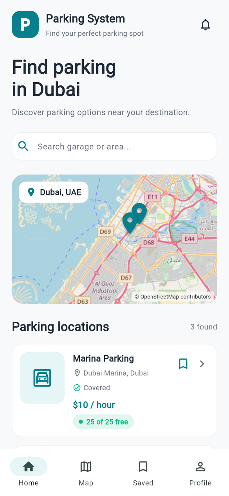
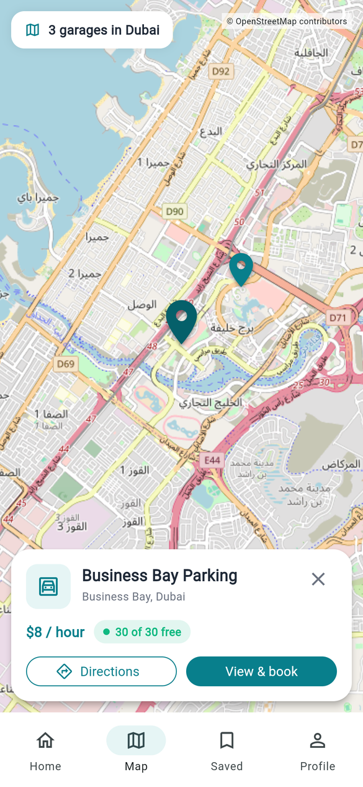
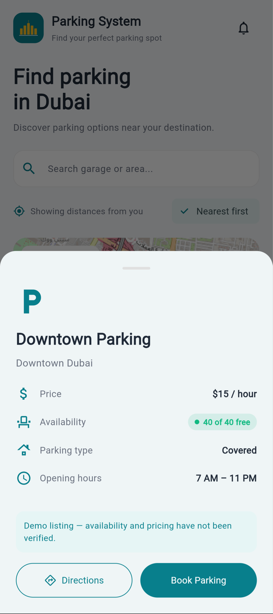
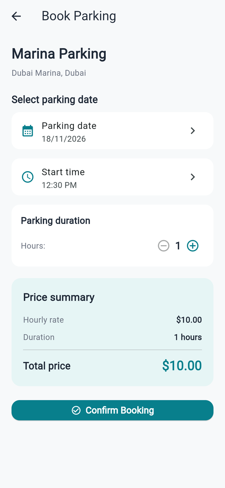
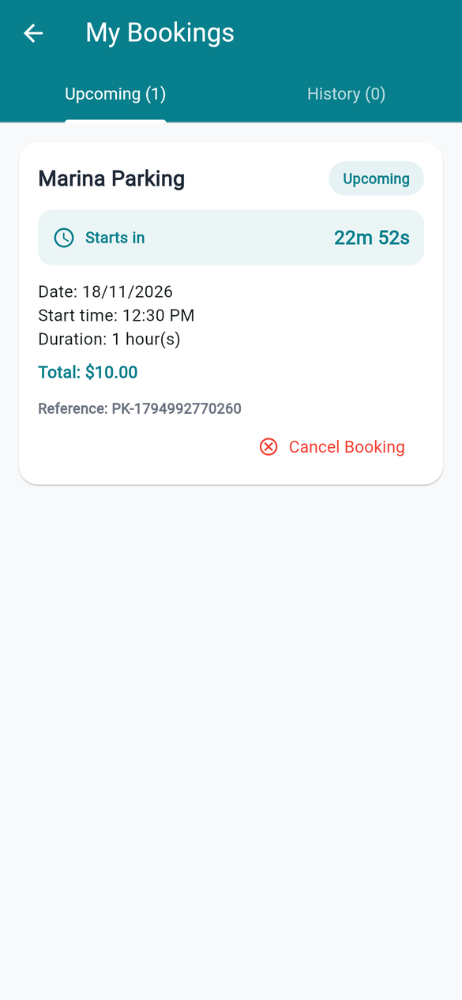

# Parking System

A Flutter app for finding and booking parking in Dubai. Browse garages on a map or in a list, see how many spaces are left, book a time slot, follow a live countdown and get a reminder before your session ends.

[**Try it live**](https://mahmoud4ui.github.io/parking_system/) · 

> The live demo runs in the browser. Reminders are only available in the Android and iOS apps.

> **This is a portfolio demo.** Garage listings, prices and availability are sample data, and everything is stored on the device. See [Limitations](#limitations) and [What I'd build next](#what-id-build-next).

<!-- Add your screenshots to docs/screenshots/ using these names, or change the paths below. -->

## Screenshots

| Onboarding | Home | Map |
| :---: | :---: | :---: |
|  |  |  |

| Garage details | Booking | My Bookings |
| :---: | :---: | :---: |
|  |  |  |

## Features

**Find parking**
- Browse garages in a list or on a map, with pins at each garage's location.
- Search by garage name, area or parking type.
- Save garages to a Saved tab.
- Open turn-by-turn directions in Google Maps with one tap.

**See availability**
- Every garage shows how many spaces are left, for example "24 of 25 free". The badge turns amber when space is running low and red when the garage is full.
- Availability updates as soon as you book or cancel, and spaces return when a booking ends.
- A time slot that is already full cannot be booked, but other times at the same garage still can.

**Book and manage bookings**
- Pick a date, start time and duration (1 to 24 hours), with a price summary before you confirm.
- Past start times are rejected, and the Confirm button locks while a booking is being saved, so a double tap cannot create two bookings.
- A confirmation page with a copyable booking reference.
- **My Bookings** is split into Upcoming and History. Each booking has a live countdown ("Starts in 23m 49s", then "Time left" with a progress bar once the session begins) and can be cancelled until it ends.
- Local reminders on Android and iOS: one 15 minutes before a session ends and one when it ends.

**Polish**
- A first-launch intro that can be replayed from Profile.
- An editable profile that is saved between sessions.
- Custom app icon and a consistent teal design.

## Tech stack

| Area | Choice |
| --- | --- |
| Framework | Flutter (Material 3) |
| Maps | [`flutter_map`](https://pub.dev/packages/flutter_map) with OpenStreetMap tiles, [`latlong2`](https://pub.dev/packages/latlong2) |
| Storage | [`shared_preferences`](https://pub.dev/packages/shared_preferences) |
| Reminders | [`flutter_local_notifications`](https://pub.dev/packages/flutter_local_notifications), [`timezone`](https://pub.dev/packages/timezone) |
| Directions | [`url_launcher`](https://pub.dev/packages/url_launcher) |
| Tests | `flutter_test` |

## Project structure

```
lib/
├── main.dart                     App entry, onboarding gate
├── data/sample_garages.dart      Sample garage listings
├── models/                       Garage and Booking (with JSON and phase logic)
├── services/
│   ├── storage_service.dart      All local persistence and availability logic
│   └── notification_service.dart Booking reminders
├── screens/                      Home, Map tab, Profile, Booking, Confirmation,
│                                 My Bookings, Onboarding
├── widgets/                      Garage card, details sheet, map, pin,
│                                 availability badge
├── theme/app_theme.dart          Colors and theme
└── utils/                        Formatters and directions helper
test/                             Unit and widget tests
```

Screens never read storage keys directly. They go through `StorageService`, and availability is derived from the saved bookings themselves instead of a separate counter, so the two cannot drift out of sync.

## Getting started

You need the [Flutter SDK](https://docs.flutter.dev/get-started/install) (Dart 3.8 or newer is recommended).

```bash
git clone <your-repo-url>
cd parking_system
flutter pub get
flutter run
```

Run on Android, iOS or Chrome. **Reminders only work on Android and iOS**; on other platforms the app simply skips them and everything else works.

### Android reminder setup

Reminders need a few one-time Android settings, which are already part of this project:

- `isCoreLibraryDesugaringEnabled = true` and the `desugar_jdk_libs` dependency in `android/app/build.gradle.kts`
- The `POST_NOTIFICATIONS` and `RECEIVE_BOOT_COMPLETED` permissions and the plugin's two receivers in `android/app/src/main/AndroidManifest.xml`

On Android 13 and newer, the app asks for notification permission the first time you book.

### Tests

```bash
flutter test
```

The tests cover booking phases (upcoming, active, completed, cancelled), availability and booking rules (full slots, cancellations, bookings in other time slots), formatting helpers, and the onboarding and availability widgets.

## Limitations

- **Sample data only.** The three garages are made up, and prices and availability are not real.
- **Local storage only.** Bookings live on one device in `shared_preferences`. There are no accounts, so two devices do not share availability.
- **No payments.** The price is calculated and shown, but nothing is charged.
- **OpenStreetMap tiles** are loaded from the public tile server, which is fine for a demo but not for production use. A real app would use a tile provider with an appropriate plan.
- **Reminders** use inexact scheduling, so on some phones they may arrive a few minutes late.

## What I'd build next

- **Backend and accounts** (Firebase or Supabase) so availability and bookings are shared between users and devices.
- **Real garage data** from a parking operator or a places API, with live occupancy.
- **Payments** and receipts.
- **Booking extension**: offer "extend by 1 hour" from the reminder notification.
- **Dark mode** and localization (Arabic and English, including right-to-left layout).
- **Search and filters** on the map (price, covered or outdoor, distance from me).

## Credits

Map data © [OpenStreetMap](https://www.openstreetmap.org/copyright) contributors.

Built by [Your name](https://github.com/mahmoud4ui).
